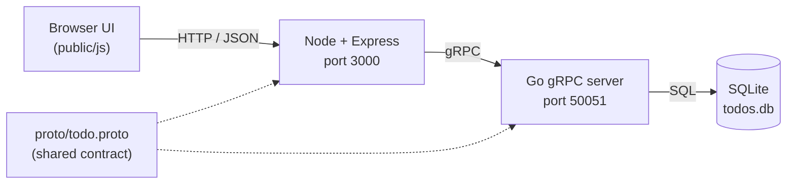
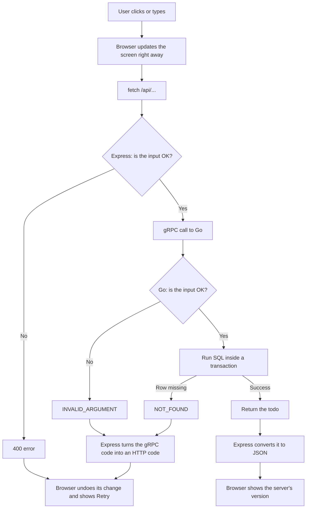
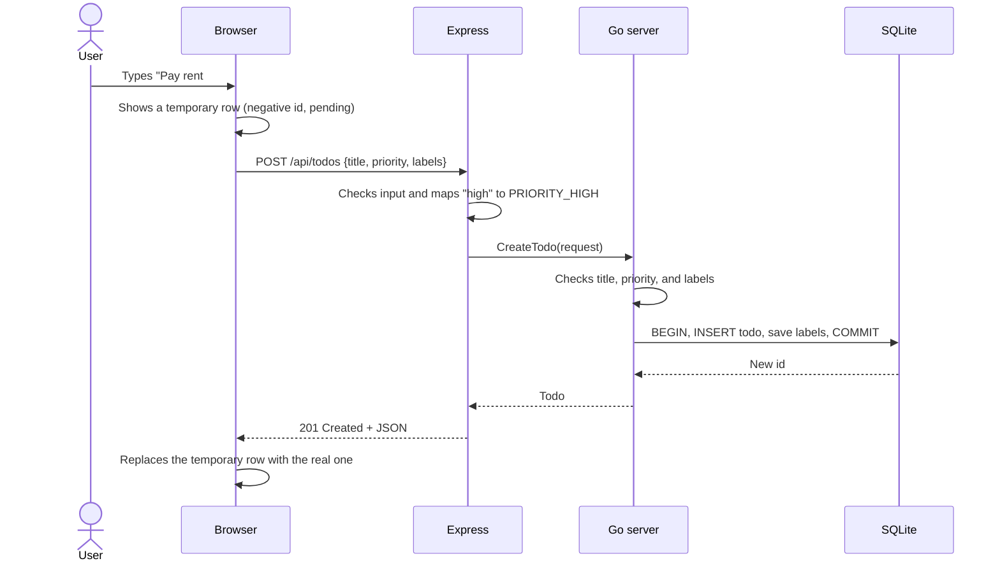
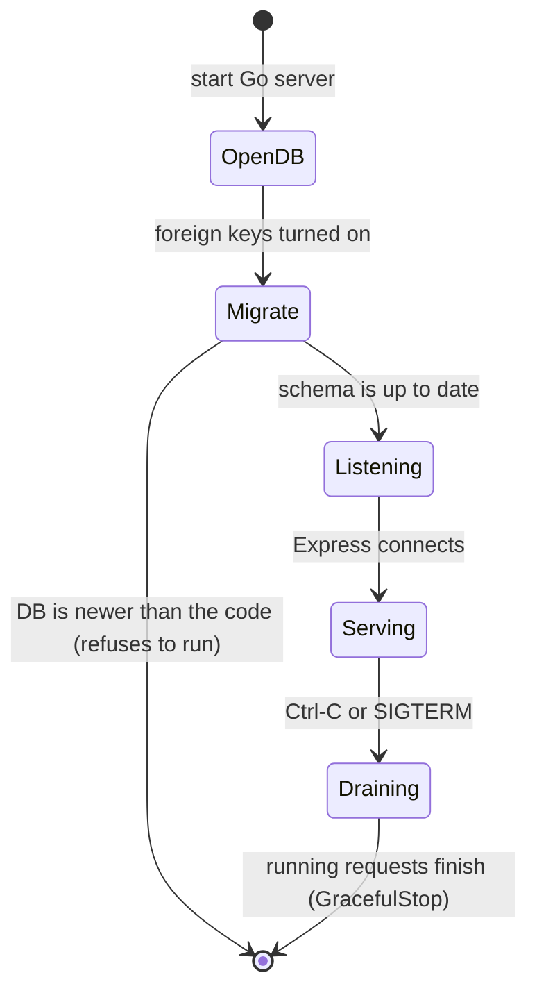
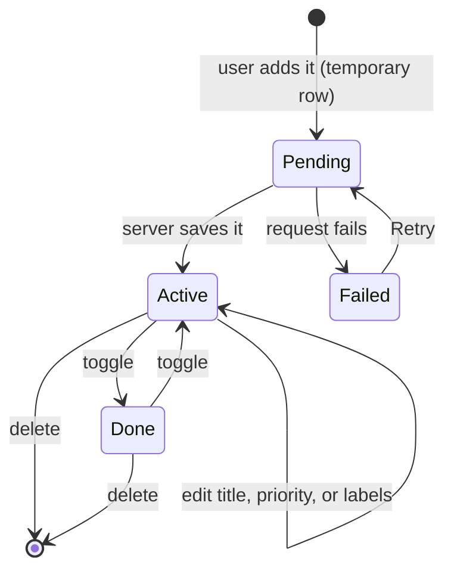
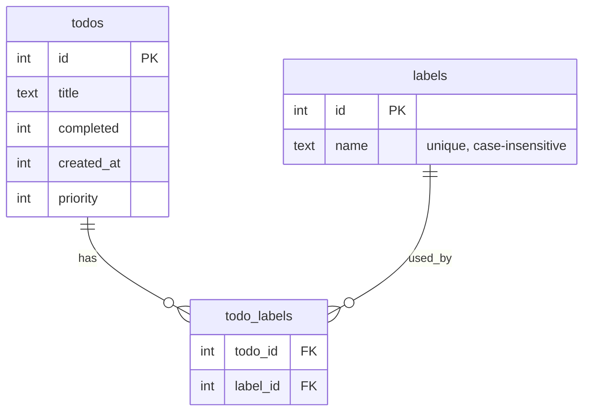

# Architecture

A todo app built in three layers. The browser talks plain HTTP/JSON, a small Node server turns that into gRPC calls, and a Go server saves everything in SQLite.

## The big picture

| Layer | Folder | Job |
|---|---|---|
| Browser UI | `client/public/` | Shows the list and sends requests. Updates the screen right away, before the server answers. |
| Express server (BFF) | `client/server.js` | Serves the web page and turns each HTTP call into a gRPC call. |
| gRPC server | `server/` | Checks the input, runs the SQL, and returns real error codes. |
| Database | `todos.db` | Stores todos, labels, and which labels belong to which todo. |
| Contract | `proto/todo.proto` | Defines the five RPCs. Go uses generated code from it, and Node reads it when it starts. |

### Why the middle layer?

Browsers can't make plain gRPC calls. The Express server sits in between, so the browser only ever sees simple JSON and can use friendly words like `"high"` instead of `PRIORITY_HIGH`.

## The API

| HTTP | gRPC | What it does |
|---|---|---|
| `GET /api/todos` | `ListTodos` | Get every todo, newest first |
| `POST /api/todos` | `CreateTodo` | Add a todo |
| `POST /api/todos/:id/toggle` | `ToggleTodo` | Mark a todo done or not done |
| `PATCH /api/todos/:id` | `UpdateTodo` | Change the title, priority, or labels |
| `DELETE /api/todos/:id` | `DeleteTodo` | Remove a todo |

## Request flow

Every request goes through the same steps:

How gRPC errors become HTTP errors: `INVALID_ARGUMENT → 400`, `NOT_FOUND → 404`, `UNAVAILABLE → 503`, and anything else → `500`. A `503` means the Go server is down. Because of that, the UI shows an error instead of an empty list.

## Sequence: adding a todo

## Lifecycle: server start and stop

## Lifecycle: a todo

## Database

- When a todo is deleted, its label links are deleted too (`ON DELETE CASCADE`).
- A label that no todo uses anymore is removed. That's why there's no "list labels" call: the browser just collects the labels from the todos it already has.
- Schema changes live in `server/migrate.go`. The current schema version is stored in SQLite's `PRAGMA user_version`.
