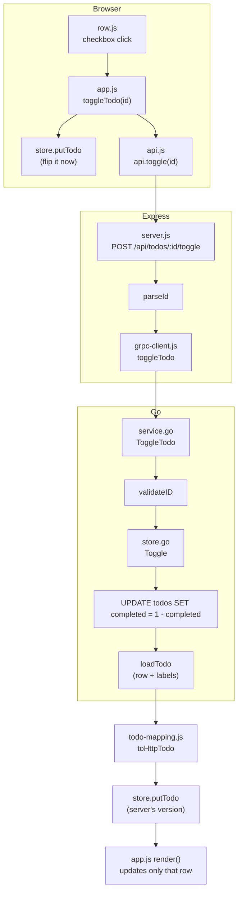
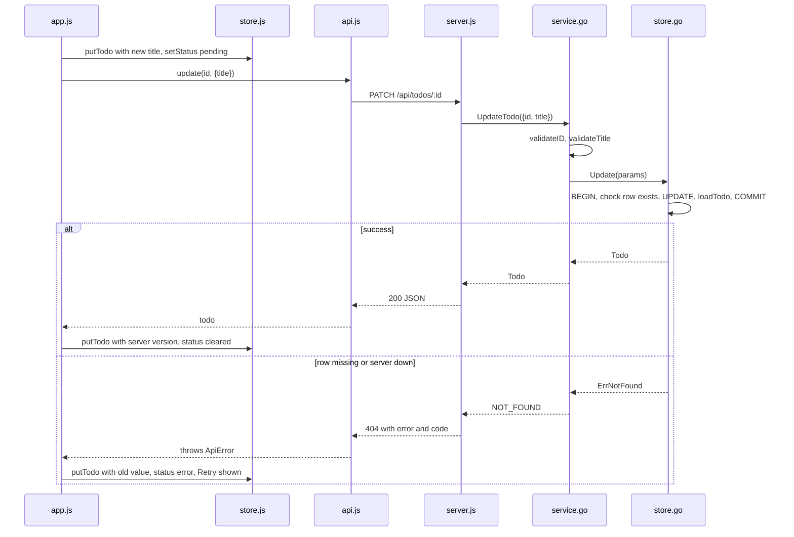
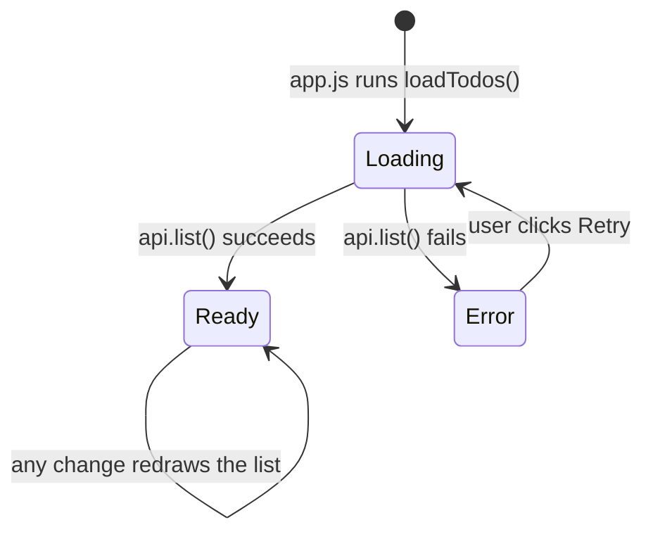
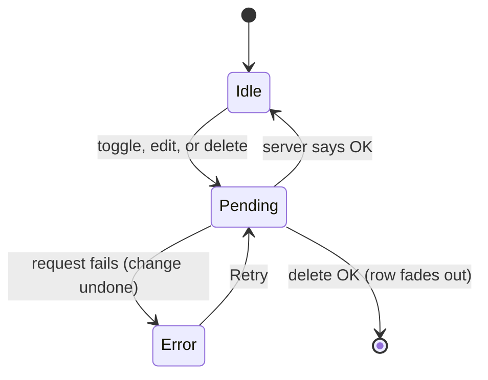

# Code Explanation

A file-by-file guide, then one action traced from start to finish.

## Files at a glance

### Go server (`server/`)

| File | What it does |
|---|---|
| `main.go` | Opens SQLite, runs migrations, starts gRPC on `:50051`, and shuts down cleanly. |
| `migrate.go` | A list of schema steps. Each one runs in its own transaction. |
| `service.go` | One function per RPC. Checks the input, calls the store, and turns errors into gRPC codes (`rpcError`). |
| `store.go` | All the SQL. Every write happens inside a transaction. |
| `pb/` | Generated from `todo.proto`. Don't edit it by hand. Run `make proto` instead. |

### Node middle layer (`client/`)

| File | What it does |
|---|---|
| `server.js` | Express routes for `/api/todos`. Checks the input, calls gRPC, and sends back JSON. |
| `grpc-client.js` | Loads `todo.proto` when Node starts and wraps each RPC in a Promise. |
| `lib/todo-mapping.js` | Converts priority names (`"high"` ↔ `PRIORITY_HIGH`) and shapes the todo JSON. |
| `lib/grpc-http.js` | Converts gRPC error codes to HTTP status codes. |

### Browser (`client/public/js/`)

| File | What it does |
|---|---|
| `app.js` | Connects everything. Holds the create, toggle, edit, and delete actions and redraws the list. |
| `store.js` | All UI state in one place. It tells the UI to redraw whenever something changes. |
| `api.js` | The only file that calls `fetch`. Any response that isn't OK becomes an `ApiError`. |
| `compose.js` | The "add task" box. Sends one submit at a time so fast Enters don't mix up the order. |
| `format.js` | Splits `"Pay rent #home"` into a title and labels, and formats times. |
| `row.js` | Builds and updates the HTML for one todo row. |
| `keys.js` | Keyboard shortcuts (`/`, arrow keys, Space, Enter, Esc). |
| `theme.js` | Light and dark mode switch. |

## How the code flows

Here's how a click on the checkbox moves through the functions:

**Main ideas**

- **Optimistic updates.** The screen changes first, and the request runs after. If the request fails, the old value is put back and the row shows a Retry button.
- **Validation happens twice.** Express catches bad input early, like a non-number id or an unknown priority name. Go is the final check, with limits on title length, label rules, and allowed enum values.
- **Toggle flips the value in SQL** with `1 - completed`, so two quick toggles can't cancel each other out.
- **Partial updates.** In `PATCH`, if a field is left out, it isn't changed. In Go, a field that wasn't sent is a `nil` pointer. `{"labels": []}` means "remove all labels".
- **Labels are cleaned up in Go** (`normalizeLabels`): the `#` is removed, then they're trimmed, made lowercase, de-duplicated, and sorted.

## Sequence: renaming a todo, success and failure

## Lifecycle: page load

When `Ready` has zero todos, the app shows "No tasks yet". `Error` shows "Couldn't load", which is a different screen. A server that is down never looks like an empty list.

## Lifecycle: one row's status

While a row is `Pending`, it ignores new clicks. That's why double-clicking toggle only counts once.

## Where to change things

| You want to... | Edit |
|---|---|
| Add a field or RPC | `proto/todo.proto`, then `make proto`, then `service.go` and `store.go`, then restart Node |
| Change the database schema | Add a new step at the end of `migrations` in `migrate.go` |
| Add an HTTP route | `client/server.js` |
| Change how a row looks | `client/public/js/row.js` |
